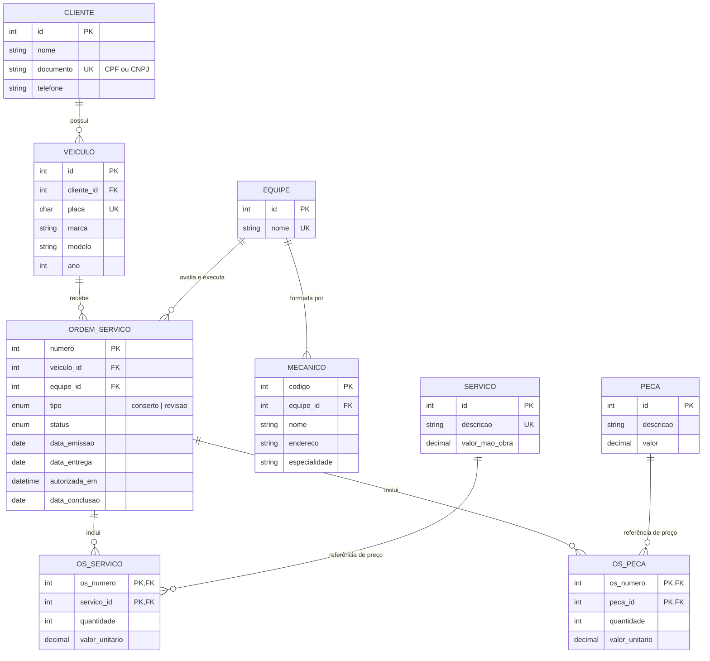

# Oficina mecânica: do esquema lógico ao banco

Desafio "Construa um Projeto Lógico de Banco de Dados do Zero", da formação SQL Database Specialist da DIO. A partir do esquema conceitual da oficina (feito no desafio anterior), o objetivo era chegar ao esquema lógico, criar o banco, popular com dados de teste e escrever consultas usando `SELECT`, `WHERE`, atributos derivados, `ORDER BY`, `HAVING` e junções.

## O contexto

Clientes levam veículos para conserto ou revisão. Cada OS fica com uma equipe de mecânicos, que avalia o carro, lista os serviços e peças e promete uma data de entrega. O valor de cada serviço vem de uma tabela de referência de mão de obra e o das peças, do cadastro de peças. O cliente autoriza e a mesma equipe executa.

## Esquema lógico




Algumas decisões que vale explicar:

- **A equipe fica na OS, não no veículo.** A narrativa diz que cada veículo é designado a uma equipe, mas um carro pode voltar meses depois e cair em outra equipe. Guardar a equipe na OS mantém o histórico certo.
- **O preço é copiado no orçamento.** `os_servico` e `os_peca` guardam o valor unitário do momento em que o item entrou na OS, preenchido por trigger a partir das tabelas de referência. Um reajuste na tabela de mão de obra não muda orçamentos já feitos.
- **O valor da OS é calculado.** A view `vw_ordem_servico` soma mão de obra e peças. Cada lado é agregado separadamente antes da junção, para não multiplicar linhas quando a OS tem vários serviços e várias peças.
- **A autorização é regra do banco.** Uma OS só fica `autorizada`, `em_execucao` ou `concluida` com `autorizada_em` preenchido. Depois da autorização, a equipe não muda e o orçamento não recebe serviços nem peças novos, o que reflete "a mesma equipe avalia e executa".
- **Datas coerentes.** A entrega prometida não pode ser antes da emissão, e uma OS concluída precisa de data de conclusão (e só ela).

## Consultas

Estão em `sql/03_consultas.sql`, cada uma com a pergunta que responde:

| # | Pergunta | Cláusulas |
| --- | --- | --- |
| 1 | Quais clientes estão cadastrados e como falar com eles? | `SELECT`, `ORDER BY` |
| 2 | Quais veículos têm mais de 5 anos de uso? | `WHERE`, atributo derivado |
| 3 | Quanto custou cada OS, separando mão de obra e peças? | junção, derivados |
| 4 | Quais OS concluídas atrasaram, e em quantos dias? | `WHERE`, `DATEDIFF`, `ORDER BY` |
| 5 | Quais clientes já gastaram mais de R$ 1.000? | junções, `GROUP BY`, `HAVING` |
| 6 | Faturamento e ticket médio por equipe | `GROUP BY`, `HAVING`, `AVG` |
| 7 | Quais serviços mais aparecem e quanto renderam? | junções, agregação |
| 8 | Quem são os mecânicos das OS em aberto? | quatro tabelas juntas |
| 9 | Qual peça pesa mais no valor de cada OS? | subconsulta correlacionada |
| 10 | Quais clientes têm mais de um veículo? | `HAVING`, `GROUP_CONCAT` |

## Rodando

Com um MySQL 8 disponível:

```bash
./testar.sh -u root -p
```

O script recria o banco `oficina` (`sql/01_schema.sql`), carrega os dados (`sql/02_dados.sql`), roda as consultas e depois `tests/verificacoes.sql`. As verificações conferem os valores calculados e tentam quebrar cada regra acima (executar sem autorização, trocar equipe depois de autorizar, placa inválida etc.). O GitHub Actions faz o mesmo contra um MySQL 8 a cada push.
